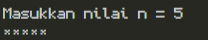
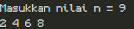
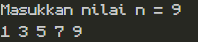
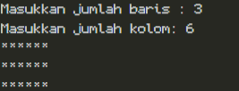
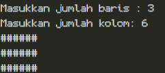
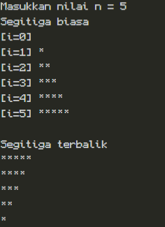
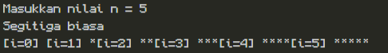
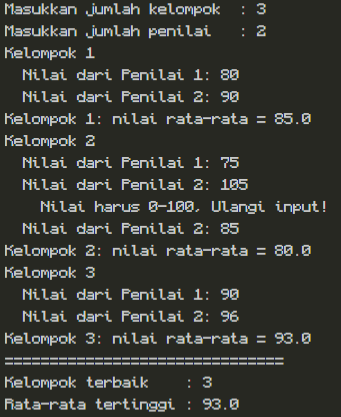
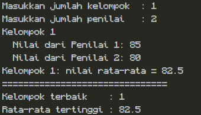
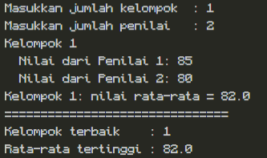

# JOBSHEET 8 - PERULANGAN 2

**Identitas Mahasiswa:**
* **Nama:** Muhammad Akbar
* **NIM:** 264107020029
* **Kelas / No. Presensi:** TI-1D / 21

---

## 1: TUJUAN PRAKTIKUM

Berikut adalah tujuan pelaksanaan praktikum pada bab ini:

1. Memahami konsep perulangan bersarang pada algoritma
2. Memahami alur perulangan bersarang
3. Mengenal sintaks perulangan bersarang
4. Mampu menerapkan perulangan bersarang untuk menyelesaikan studi kasus sederhana.

---

## 2: HASIL PERCOBAAN & ANALISIS

### 2.1 Percobaan 1: Review Perulangan 1

Percobaan ini mengulang konsep perulangan FOR sebelum mempelajari perulangan bersarang. Program menampilkan karakter * sebanyak n kali secara mendatar (ke arah samping).

#### 2.1.1 Kode Program Java

```java
import java.util.Scanner;

public class Star21 {
    public static void main(String[] args) {
        Scanner sc = new Scanner(System.in);
        System.out.print("Masukkan nilai n = ");
        int n = sc.nextInt();

        for (int i = 1; i <= n; i++) {
            System.out.print("*");
        }
        System.out.println();
        sc.close();
    }
}
```

#### 2.1.2 Hasil Running / Screenshot Output



#### 2.1.3 Jawaban Pertanyaan / Pertanyaan Refleksi

* **Pertanyaan 1:** Jika inisialisasi $i=1$ diubah menjadi $i=0$ tanpa mengubah kondisi, berapa karakter * yang tercetak ketika $n=5$? Jelaskan.
  * **Jawab:** Karakter * yang akan muncul adalah 6 karena jika kondisi inisialisasi awal adalah 0 maka blok perulangan akan berjalan sebanyak 6 kali(i = 0,i = 1,i = 2,i = 3,i = 4, dan i = 5) dan saat i = 6 blok perulangan tidak akan dijalankan lagi karena sudah tidak memenuhi kondisi (6 tidak kurang dari sama dengan 5)

* **Pertanyaan 2:** Jika kondisi $i<=n$ diganti menjadi $i<n$, berapa kali perulangan dijalankan saat $n=5$? Mengapa hasilnya berbeda?
  * **Jawab:**  Perulangan akan terjadi 4 kali. Hasilnya berbeda karena pada kondisi $i<=n$ dan iterasi 5 maka akan bernilai true karena 5 lebih kecil sama dengan 5 dan akan print bintang, sedangkan pada kondisi $i<n$ jika iterasi 5 maka akan bernilai false karena 5 tidak lebih kecil dari 5 sehingga bintang tidak di print. Oleh karena itulah terdapat perbedaan 1 bintang.

* **Pertanyaan 3:** Prediksi output potongan kode berikut ketika $n=9$, kemudian buktikan dengan mengganti perulangan FOR pada program Anda dan menjalankannya.
  ```java
  for (int i = 2; i <= n; i += 2) {
      System.out.print(i + " ");
  }
  ```
  Modifikasi kode tersebut agar mencetak bilangan ganjil positif yang tidak melebihi n.
  * **Jawab:** 
  Hasil run sebelum modifikasi:

  


  modifikasi kode:
  ```java
  for (int i = 1; i <= n; i += 2) {
      System.out.print(i + " ");
  }
  ```
  Hasil run setelah dimodifikasi:

  

* **Pertanyaan 4:** Jelaskan mengapa perubahan increment `i++` menjadi `i--` (dengan kondisi tetap $i<=n$) membuat perulangan berjalan terus-menerus dan tidak berhenti dalam waktu wajar untuk n positif.
  * **Jawab:** Karena iterasi terus berkurang menjauhi nilai n yang menjadi batas kondisi perulangan (Jika melebihi n maka aka false dan perulangan berakhir), oleh karena itu kondisi selalu bernilai true sehingga program tidak berhenti karena tidak mungkin melebihi n jika perintah updatenya adalah `i--`

---

### 2.2 Percobaan 2: Pola Bintang Persegi Panjang (Nested FOR)

Pada percobaan ini digunakan nested loop FOR untuk mencetak persegi panjang bintang. Jumlah baris dan kolom dimasukkan secara terpisah sehingga peran kedua loop dapat diamati dengan jelas: outer loop mengatur baris, sedangkan inner loop mengatur kolom.

#### 2.2.1 Kode Program Java

```java
import java.util.Scanner;

public class Rectangle21 {
    public static void main(String[] args) {
        Scanner sc = new Scanner (System.in);
        System.out.print("Masukkan jumlah baris : ");
        int baris = sc.nextInt();
        System.out.print("Masukkan jumlah kolom: ");
        int kolom = sc.nextInt();

        for (int i = 1; i <= baris; i++) {
            for (int j = 1; j <= kolom; j++) {
                System.out.print("*");
            }
            System.out.println();    
        }
        sc.close();
    }
}
```

#### 2.2.2 Hasil Running / Screenshot Output



#### 2.2.3 Jawaban Pertanyaan / Pertanyaan Refleksi

* **Pertanyaan 1:** Tentukan fungsi variabel `i` dan `j` pada program tersebut.
  * **Jawab:** 
    * variabel `i` berfungsi sebagai counter untuk mengatur jumlah baris
    * variabel `j` berfungsi sebagai counter untuk mengatur jumlah kolom

* **Pertanyaan 2:** Berapa kali outer loop, inner loop, dan perintah `print("*")` dijalankan untuk baris = 4 dan kolom = 7?
  * **Jawab:** 
    * outer loop berjalan 4 kali
    * inner loop berjalan 28 kali 
    * perintah `print("*")` berjalan 28 kali

* **Pertanyaan 3:** Apa yang terjadi jika batas perulangan luar dan dalam ditukar (outer menggunakan kolom, inner menggunakan baris)? Gunakan baris = 3 dan kolom = 6 untuk menjelaskan.
  * **Jawab:** Yang terjadi jika ditukar adalah jumlah kolom yang diinput akan menjadi baris dan jumlah baris yang diinput akan menjadi kolom. Jika baris = 3 dan kolom = 6 maka program akan mencetak 6 baris dan juga 3 kolom:
      ```
      ***
      ***
      ***
      ***
      ***
      ***
      ```

* **Pertanyaan 4:** Jelaskan akibat penghapusan `System.out.println();` setelah inner loop.
  * **Jawab:** Setiap setelah inner loop tidak akan melakukan pindah baris. Maka baris dan kolom akan menjadi 1 baris saja. Contohnya jika baris = 3 dan kolom = 3, maka akan menghasilkan ```*********``` 

* **Pertanyaan 5:** Modifikasi program agar karakter yang dicetak adalah `#`.
  * **Jawab:** 
  ```java
  import java.util.Scanner;

  public class Rectangle21Pertanyaan {
      public static void main(String[] args) {
          Scanner sc = new Scanner (System.in);
          System.out.print("Masukkan jumlah baris : ");
          int baris = sc.nextInt();
          System.out.print("Masukkan jumlah kolom: ");
          int kolom = sc.nextInt();

          for (int i = 1; i <= baris; i++) {
              for (int j = 1; j <= kolom; j++) {
                  System.out.print("#");
              }
              System.out.println();    
          }
          sc.close();
      }
  }
  ```
  Hasil run:

  

---

### 2.3 Percobaan 3: Debugging Bintang Segitiga - Nested WHILE

Kode awal pada percobaan ini sengaja dibuat belum menghasilkan format segitiga yang benar. Tugas Anda adalah mengidentifikasi kesalahannya dan memperbaikinya tanpa mengganti struktur WHILE menjadi FOR.

#### 2.3.1 Kode Program Java

Sebelum modifikasi
```java
import java.util.Scanner;

public class Triangle21 {
    public static void main(String[] args) {
        Scanner sc = new Scanner(System.in);
        System.out.print("Masukkan nilai n = ");
        int n = sc.nextInt();
        
        // Segitiga biasa
        System.out.println("Segitiga biasa");
        int i = 0;
        while (i <= n) {
            int j = 0;
            while (j < i) {
                System.out.print("*");
                j++;
            }
            i++;
        }

        sc.close();
    }
}
```

Setelah modifikasi
```java
import java.util.Scanner;

public class Triangle21 {
    public static void main(String[] args) {
        Scanner sc = new Scanner(System.in);
        System.out.print("Masukkan nilai n = ");
        int n = sc.nextInt();
        
        // Segitiga biasa
        System.out.println("Segitiga biasa");
        int i = 1;
        while (i <= n) {
            int j = 0;
            while (j < i) {
                System.out.print("*");
                j++;
            }
            i++;
            System.out.println();
        }
        // Segitiga terbalik
        System.out.println();
        System.out.println("Segitiga terbalik");
        i = n;
        while (i >= 1) {
            int j = 0;
            while (j < i) {
                System.out.print("*");
                j++;
            }
            i--;
            System.out.println();
        }

        sc.close();
    }
}
```

#### 2.3.2 Hasil Running / Screenshot Output



#### 2.3.3 Jawaban Pertanyaan / Pertanyaan Refleksi

* **Pertanyaan 1:** Sebutkan ketidaksesuaian output awal dan minimal dua perbaikan yang diperlukan untuk menghasilkan pola segitiga bertingkat.
  * **Jawab:** Output awal adalah: 
   
   

   Sedangkan output targetnya adalah:

   ```
   *
   **
   ***
   ****
   *****
   ```

   Dua perbaikan yang diperlukan: 
   * Mengubah inisialisasi `int i = 0` menjadi `int i = 1` agar baris pertama yang tidak menghasilkan bintang tidak diprint
   * Menambahkan `System.out.println();` di dalam outer loop (setelah inner loop selesai dijalankan) agar baris yang dihasilkan berganti setiap outerloop dijalankan sehingga menghasilkan segitiga, bukan * satu baris saja.

* **Pertanyaan 2:** Jelaskan peran variabel `i` dan `j`. Mengapa nilai `j` harus diinisialisasi kembali ke 0 pada setiap iterasi outer loop? Apa yang terjadi jika `j` tidak di-reset?
  * **Jawab:** 
    * Peran `i`: sebagai counter outerloop untuk menghasilkan baris sejumlah `n`/input user (dapat dilihat di kondisi `while (i <= n) {`)
    * Peran `j`: sebagai counter innerloop untuk menghasilkan bintang sejumlah iterasi `j` dan tidak boleh sama dan melebihi nilai variabel `i` (dapat dilihat dari kondisi `while (j < i) {`)
    * Yang terjadi jika `j` tidak direset adalah nilai `j` pasti akan selalu 1 nilai dibawah `i` jika tidak direset, karena itu bintang yang dihasilkan hanya berjumlah 1 (Selisih j dengan i).

* **Pertanyaan 3:** Jelaskan perubahan inisialisasi, kondisi, dan perubahan nilai (update) pada outer loop yang diperlukan untuk membentuk segitiga terbalik.
  * **Jawab:** `
    * Inisialisasi `int i = 1;` outerloop diubah menjadi `int i = n;` karena jumlah bintang yang paling atas diharapkan sama dengan input user (`n`)
    * Kondisi `while (i <= n) {` outerloop diubah menjadi `while (i >= 1) {` agar perulangan tetap berjalan selama `i` belum kuranh dari 1.
    * Perubahaan update `i++` outerloop diubah menjadi `i--` agar nilai berkurang 1 pada setiap pergantian baris.

---

### 2.4 Percobaan 4: Studi Kasus Nilai Tugas Proyek Kelompok

Dalam penilaian proyek kelompok, setiap kelompok memperoleh nilai dari sejumlah penilai. Program menerima jumlah kelompok dan jumlah penilai yang sama untuk setiap kelompok, kemudian menghitung rata-rata nilai tiap kelompok dan menentukan kelompok dengan rata-rata tertinggi.

#### 2.4.1 Kode Program Java

```java
import java.util.Scanner;

public class NilaiKelompok21 {
    public static void main(String[] args) {
        Scanner sc = new Scanner (System.in);

        System.out.print("Masukkan jumlah kelompok  : ");
        int jumlahKelompok = sc.nextInt();
        System.out.print("Masukkan jumlah penilai   : ");
        int jumlahPenilai = sc.nextInt();

        if (jumlahKelompok <= 0 || jumlahPenilai <= 0) {
            System.out.println("Jumlah kelompok dan penilai harus > 0");
        } else {
            int nomorKelompok = 1;
            double rataTertinggi = -1;
            int kelompokTerbaik = 0;

            while (nomorKelompok <= jumlahKelompok) { 
                System.out.println("Kelompok " + nomorKelompok);
                double totalNilai = 0;

                for (int j = 1; j <= jumlahPenilai; j++) {
                    int nilai;
                    do { 
                        System.out.print("  Nilai dari Penilai " + j + ": ");
                        nilai = sc.nextInt();
                        if (nilai < 0 || nilai > 100) {
                            System.out.println("    Nilai harus 0-100, Ulangi input!");
                        }
                    } while (nilai < 0 || nilai > 100);
                    totalNilai += nilai;
                }

                double rataNilai = totalNilai / jumlahPenilai;
                System.out.println("Kelompok " + nomorKelompok + ": nilai rata-rata = " + rataNilai);
                    
                if (rataNilai > rataTertinggi) {
                    rataTertinggi = rataNilai;
                    kelompokTerbaik = nomorKelompok;
                }

                nomorKelompok++;
            }
            System.out.println("===============================");
            System.out.println("Kelompok terbaik    : " + kelompokTerbaik);
            System.out.println("Rata-rata tertinggi : " + rataTertinggi);
        }
    }    
}
```

#### 2.4.2 Hasil Running / Screenshot Output



#### 2.4.3 Jawaban Pertanyaan / Pertanyaan Refleksi

* **Pertanyaan 1:** Mengapa `totalNilai` perlu di-reset di dalam outer loop, tetapi `rataTertinggi` tidak boleh di-reset pada setiap kelompok?
  * **Jawab:** 
    * `totalNilai` perlu di-reset di dalam outer loop agar `totalNilai` hanya memiliki nilai jumlah nilai dalam satu kelompok saja dan tidak tercampur dengan nilai kelompok lain.
    * `rataTertinggi` tidak boleh di-reset pada setiap kelompok karena `rataTertinggi` digunakan sebagai filter rata-rata tertinggi, sehingga cara untuk merubahnya bukan reset pada setiap kelompok tetapi dengan membandingkan `rataNilai` dengan `rataTertinggi` sebelumnya. Jika `rataNilai` lebih besar dari `rataTertinggi` sebelumnya maka nilai dari `rataTertinggi` akan digantikan oleh `rataNilai`.

* **Pertanyaan 2:** Untuk 3 kelompok dan 2 penilai (tanpa input yang salah), berapa kali badan perulangan FOR dijalankan secara keseluruhan?
  * **Jawab:** Badan perulangan FOR dijalankan 6 kali secara keseluruhan
    * While 1 : FOR berjalan 2 kali 
    * While 2 : FOR berjalan 2 kali 
    * While 3 : FOR berjalan 2 kali 
    * Sehingga totalnya adalah berjalan 6 kali.

* **Pertanyaan 3:** Apa yang terjadi jika `totalNilai` dideklarasikan sebagai `int` dan rata-rata dihitung menggunakan pembagian dua bilangan bulat? Berikan contoh nilai.
  * **Jawab:** 
    * jika `totalNilai` dideklarasikan sebagai `int` dan rata-rata dihitung menggunakan pembagian dua bilangan bulat:
      Contoh nilai : 85 dan 80

      Hasil run(`double`): 

      

      Hasil run(`int`):

      

      Dapat dilihat dari kedua hasil tersebut bahwa terlihat perbedaan di `rataNilai` 
      * Pada saat `double` 85+80 adalah 165.0 dan ketika dihitung di `rataNilai` yaitu 165.0/2 hasilnya adalah 82.5 (Akurat)
      * Pada saat `int` 85+80 adalah 165 dan ketika dihitung di `rataNilai` yaitu 165/2 hasilnya adalah 82 karena int+int akan menghasilkan nilai bulat(bukan desimal)


* **Pertanyaan 4:** Mengapa `rataTertinggi` diberi nilai awal -1, bukan 0? Berikan contoh input yang membuat hasil salah apabila nilai awalnya 0.
  * **Jawab:** `rataTertinggi` diberi nilai awal -1 adalah karena sebagai pembanding awal. Sehingga jika kelompok 1 memiliki `rataNilai` 0 maka `rataNilai` kelompok tersebut akan menggantikan nilai `rataTertinggi`. Sehingga meskipun jika semua kelompok memiliki `rataNilai = 0` variabel `kelompokTerbaik` tetap diperbarui dan tidak menghasilkan output kelompok 0
  Contoh input yang menghasilkan nilai salah
  * Kelompok 1: `rataNilai = 0`. Pengecekan `if (rataNilai > rataTertinggi) {` false sehingga nilai `kelompokTerbaik` tidak diperbarui.
  * Kelompok 2: `rataNilai = 0`. Pengecekan `if (rataNilai > rataTertinggi) {` false sehingga nilai `kelompokTerbaik` tidak diperbarui.
  * Dampaknya adalah output program `Kelompok terbaik adalah kelompok 0` padahal tidak ada kelompok 0

* **Pertanyaan 5:** Program ini memiliki tiga tingkat perulangan. Sebutkan masing-masing jenis perulangan beserta perannya.
  * **Jawab:** 
    * 1\. perulangan `while` digunakan untuk mengulang blok sejumlah `jumlahKelompok` yang diinput oleh user, reset variabel `totalNilai`, dan update `kelompokTerbaik` `dan rataTertinggi`
    * 2\. perulangan `for` digunakan untuk mengulangi blok sejumlah `jumlahPenilai` yang diinput oleh user, dan menghitung total nilai dalam satu kelompok.
    * 3\. perulangan `do-while` sebagai validasi input nilai. Jika nilai yang diinput tidak dalam rentang 0-100 maka program akan meminta user untuk mengulangi input.

---

## 3: TUGAS MANDIRI

Berikut adalah daftar tugas yang dikerjakan pada Jobsheet ini:

* [x] **Tugas 1:** Program mencetak pola bilangan 1 sampai nomor baris (Pola Bilangan Bertingkat)
* [x] **Tugas 2:** Program menampilkan tabel perkalian berukuran $n \times n$
* [x] **Tugas 3:** Program rekap penjualan beberapa toko

### 3.1 Implementasi Kode Tugas

#### Tugas 1 - Pola Bilangan Bertingkat

```java
import java.util.Scanner;

public class Tugas1_21 {
    public static void main(String[] args) {
        Scanner sc = new Scanner(System.in);

        System.out.print("Masukkan nilai n = ");
        int n = sc.nextInt();
        int total = 0;

        int i = 1;
        while (i <= n) {
            int j = 1;
            while (j <= i) {
                System.out.print(j + " ");
                j++;
            }
            total += i;
            i++;
            System.out.println();
        }
        System.out.println("Total angka tercetak : " + total);
        sc.close();
    }
}
```

#### Tugas 2 - Tabel Perkalian

```java
import java.util.Scanner;

public class Tugas2_21 {
    public static void main(String[] args) {
        Scanner sc = new Scanner (System.in);

        int total = 0;
        System.out.print("Masukkan n : ");
        int n = sc.nextInt();

        for (int i = 1; i <= n; i++) {
            for (int j = 1; j <= n; j++) {
                System.out.print(i*j + "\t");
                int angka = i*j;
                total += angka;
            }
            System.out.println(); 
        }
        System.out.println("Jumlah seluruh angka : " + total);
        sc.close();
    }
}
```

#### Tugas 3 - Rekap Penjualan Beberapa Toko

```java
import java.util.Scanner;

public class Tugas3_21 {
    public static void main(String[] args) {
        Scanner sc = new Scanner (System.in);

        // input jumlah toko
        int toko;
        do { 
            System.out.print("Masukkan jumlah toko: ");
            toko = sc.nextInt();
            if (toko < 1) {
                System.out.println("jumlah toko tidak valid (Dibawah 1) , masukkan ulang");
            }
        } while (toko < 1);

        // Perulangan pelanggan dan barang
        int i = 1;
        int totalBarang = 0;
        int barangTerbanyak = 0;
        String ringkasanToko = "";
        int tokoTerbanyak = 0;
        while (i <= toko) { 
            // input jumlah pelanggan
            int totalBarangToko = 0;
            int pelanggan;
            do{
                System.out.print("Masukkan jumlah pelanggan toko " + i + ": ");
                pelanggan = sc.nextInt();
                if (pelanggan < 0) {
                    System.out.println("Jumlah pelanggan tidak valid (Dibawah 0), masukkkan ulang");
                }
            } while (pelanggan < 0);

            // perulangan barang
            int j = 1;
            while (j <= pelanggan) { 
                // input jumlah barang yang dibeli pelanggan ke-j di toko ke-i
                int barang;
                do {
                    System.out.print("Masukkan barang pelanggan " + j + ": ");
                    barang = sc.nextInt();
                    if (barang < 0) {
                        System.out.println("Jumlah barang tidak valid, Masukkan ulang!");
                    }
                } while (barang < 0);
                //penjumlahan barang
                totalBarang += barang;
                totalBarangToko += barang;
                j++;
            }
            // filter toko dengan barang terbanyak
            if (totalBarangToko > barangTerbanyak) {
                barangTerbanyak = totalBarangToko;
                tokoTerbanyak = i;
            }
            ringkasanToko += "Toko "+ i + " - pelanggan: "+ pelanggan +", total barang: "+ totalBarangToko +"\n";
            i++; 
        }
        // Output program
        System.out.println();
        System.out.println("================= Ringkasan per-Toko =====================");
        System.out.println(ringkasanToko);
        System.out.println("================= Ringkasan seluruh toko =================");
        System.out.println("Total barang seluruh toko: "+ totalBarang);
        System.out.println("Toko dengan barang terbanyak: "+ tokoTerbanyak);
        System.out.println("----------------------------------------------------------");
        sc.close();
    }
}

```

---

## 4: KESIMPULAN
Mempelajari perulangan di dalam perulangan (nested loop) penting untuk menyelesaikan problem yang memerlukan input berulang kali di dalam proses perulangan pertama seperti pembuatan pola karakter bertingkat, input jumlah penjualan di berbagai toko di berbagai hari, dan lain-lain. Setelah menyelesaikan jobsheet ini dapat disimpulkan bahwa innerloop selalu menyelesaikan iterasinya terlebih dahulu untuk setiap satu kali outerloop dijalankan. 