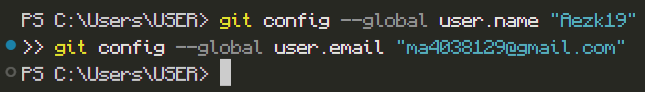
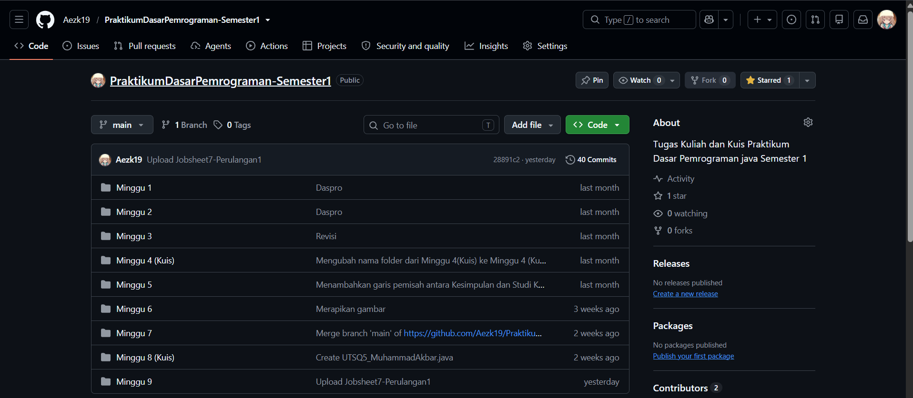
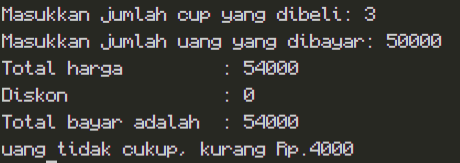
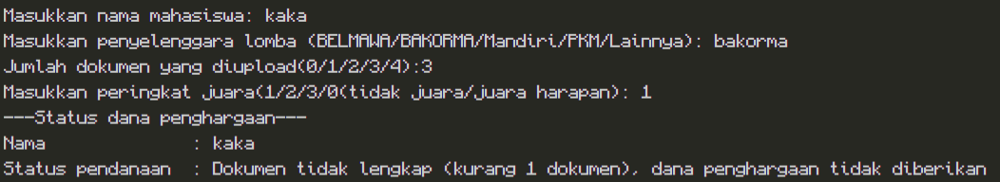
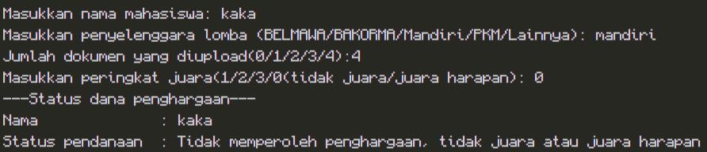
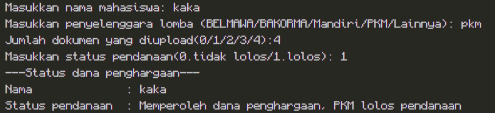
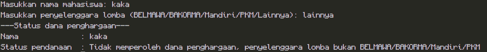

# JOBSHEET 6 - STUDI KASUS PEMILIHAN DENGAN GIT DAN GITHUB

**Identitas Mahasiswa:**
* **Nama:** Muhammad Akbar
* **NIM:** 264107020029
* **Kelas / No. Presensi:** TI-1D/21

---

## 1: TUJUAN PRAKTIKUM

Berikut adalah tujuan pelaksanaan praktikum pada bab ini:

1. Mahasiswa mampu menyelesaikan studi kasus menggunakan struktur pemilihan dasar dan pemilihan bersarang
2. Mahasiswa mampu menyimpan dan mengumpulkan pekerjaan menggunakan Git dan GitHub melalui Visual Studio Code
3. Mahasiswa mampu berkolaborasi dengan teman menggunakan GitHub

---

## 2: HASIL PERCOBAAN & ANALISIS

### 2.1 Percobaan 1: Persiapan Awal & Menyiapkan Repository

Pada percobaan ini, dilakukan konfigurasi awal Git di Visual Studio Code dan pembuatan *repository* di GitHub.

#### 2.1.1 Kode Terminal (Git Bash / CMD)
```bash
git config --global user.name "Aezk19"
git config --global user.email "ma4038129@gmail.com"
```

#### 2.1.2 Hasil Running / Screenshot Output





---

### 2.2 Percobaan 2: Studi Kasus 1 - Pemilihan Dasar

Membuat program kasir sederhana untuk Kedai Kopi Senja yang menjual Kopi Susu Gula Aren seharga Rp18.000 per cup. Program memberikan diskon 10% untuk pembelian minimal Rp100.000, serta menghitung total bayar dan kembalian.

#### 2.2.1 Kode Program Java
```java
import java.util.Scanner;

public class StudiKasus1_21 {
    public static void main(String[] args) {
        Scanner sc = new Scanner (System.in);

        int hargaPerCup = 18000;
        int jumlahCup, uangBayar;
        int totalHarga, diskon, totalBayar;
        int kembalian, kurang;

        System.out.print("Masukkan jumlah cup yang dibeli: ");
        jumlahCup = sc.nextInt();
        System.out.print("Masukkan jumlah uang yang dibayar: ");
        uangBayar = sc.nextInt();
        sc.close();

        totalHarga = jumlahCup *  hargaPerCup;
        diskon = 0;

        if (totalHarga >= 100000) {
            diskon = totalHarga * 10 / 100;
        }
        totalBayar = totalHarga - diskon;
        System.out.println("Total harga         : "+totalHarga);
        System.out.println("Diskon              : "+diskon);
        System.out.println("Total bayar adalah  : "+totalBayar);

        if (uangBayar >= totalBayar) {
            kembalian = uangBayar - totalBayar;
            System.out.println("Kembali         : "+kembalian);
        } else {
            kurang = totalBayar - uangBayar;
            System.out.println("uang tidak cukup, kurang Rp."+kurang);
        }
    }
}
```

#### 2.2.2 Hasil Running / Screenshot Output



#### 2.2.3 Commit & Push Repository
Program telah disimpan dengan tahapan Git sebagai berikut:
1. `Add` ke dalam staging area.
2. `Commit` dengan pesan: *"Logika diskon"* dan *"Logika kembalian dan uang kurang"*.
3. `Push` berhasil terkirim ke *repository* GitHub `PraktikumDasarPemograman`.

---

### 2.3 Percobaan 3: Studi Kasus 2 - Pemilihan Bersarang

Membuat program untuk Admin Kemahasiswaan mengecek status dana penghargaan mahasiswa dengan syarat kegiatan (BELMAWA/BAKORMA/Mandiri/PKM), kejuaraan, dan kelengkapan dokumen (harus 4 dokumen: Surat Tugas, Sertifikat, Foto, Poster).

#### 2.3.1 Kode Program Java

```java
import java.util.Scanner;;

public class StudiKasus2_21 {
    public static void main(String[] args) {
        Scanner sc = new Scanner(System.in);

        String namaMahasiswa;
        String jenisKegiatan;
        String pesan;
        byte jumlahDokumenUp;
        byte rank;
        byte statusPendanaan;
        int dokumenKurang;

        System.out.print("Masukkan nama mahasiswa: ");
        namaMahasiswa = sc.nextLine();
        System.out.print("Masukkan penyelenggara lomba (BELMAWA/BAKORMA/Mandiri/PKM/Lainnya): ");
        jenisKegiatan = sc.nextLine();

        if (jenisKegiatan.equalsIgnoreCase("belmawa") || jenisKegiatan.equalsIgnoreCase("bakorma") || jenisKegiatan.equalsIgnoreCase("mandiri")) {
            System.out.print("Jumlah dokumen yang diupload(0/1/2/3/4): ");
            jumlahDokumenUp = sc.nextByte();
            System.out.print("Masukkan peringkat juara(1/2/3/0(tidak juara/juara harapan): ");
            rank = sc.nextByte();
            if (jumlahDokumenUp == 4) {
                if (rank>= 1 && rank <= 3) {
                    pesan = String.format("Memperoleh dana penghargaan, juara %s di lomba %s", rank, jenisKegiatan);
                } else {
                    pesan = "Tidak memperoleh penghargaan, tidak juara atau juara harapan";
                }
            } else if (jumlahDokumenUp < 4 && jumlahDokumenUp >= 0) {
                dokumenKurang = 4-jumlahDokumenUp;
                pesan = String.format("Dokumen tidak lengkap (kurang %d dokumen), dana penghargaan tidak diberikan", dokumenKurang);
            } else {
                pesan = "Jumlah dokumen tidak valid";
            } 
        } else if (jenisKegiatan.equalsIgnoreCase("pkm")) {
            System.out.print("Jumlah dokumen yang diupload(0/1/2/3/4): ");
            jumlahDokumenUp = sc.nextByte();
            System.out.print("Masukkan status pendanaan(0.tidak lolos/1.lolos): ");
            statusPendanaan = sc.nextByte();
            if (jumlahDokumenUp == 4) {
                if (statusPendanaan == 1) {
                    pesan = "Memperoleh dana penghargaan, PKM lolos pendanaan";
                } else {
                    pesan = "Tidak memperoleh penghargaan, status pendanaan tidak lolos";
                }
            } else if (jumlahDokumenUp < 4 && jumlahDokumenUp >= 0) {
                dokumenKurang = 4-jumlahDokumenUp;
                pesan = String.format("Dokumen tidak lengkap (kurang %d dokumen), dana penghargaan tidak diberikan", dokumenKurang);
            } else {
                pesan = "Jumlah dokumen tidak valid";
            }
        } else {
            pesan = "Tidak memperoleh dana penghargaan, penyelenggara lomba bukan BELMAWA/BAKORMA/Mandiri/PKM";
        }
        
        sc.close();
        System.out.println("---Status dana penghargaan---");
        System.out.println(String.format("Nama              : %s\nStatus pendanaan  : %s", namaMahasiswa, pesan));
    }
}
```

#### 2.3.2 Hasil Running / Screenshot Output









---

### 2.4 Percobaan 4: Uji Silang Program Teman

Berkolaborasi dengan teman (mengundang *Collaborator* di GitHub) untuk saling menarik (`Pull`), menguji (`Test`), dan mendorong kembali (`Push`) kode program.

#### 2.4.1 Hasil Uji SK2 (Tercatat di Hasil_Uji_SK2_Oleh_Achmad_Labib.md)

| Jenis Kegiatan | Dokumen | Peringkat | Output Yang Dihasilkan | Sesuai ? |
| --- | --- | --- | --- | --- |
| Bakorma | 03 | Juara 01 | Dokumen tidak lengkap (kurang 1 dokumen), dana penghargaan tidak diberikan | Sesuai |
| Mandiri | 04 | Tidak Juara | Tidak memperoleh penghargaan, tidak juara atau juara harapan | Sesuai |
| PKM | 04 | Lulus | Memperoleh dana penghargaan | Sesuai |
| Lainnya | 04 | - | Tidak memperoleh dana penghargaan, penyelenggara lomba bukan BELMAWA/BAKORMA/Mandiri/PKM | Sesuai |

---

## 4: KESIMPULAN

Pemilihan bersarang (*Nested IF*) sangat penting untuk menangani kondisi program yang membutuhkan beberapa lapis pernyataan. Selain itu, penguasaan **Git** dan **GitHub** mempermudah *programmer* dalam melacak perubahan, mendokumentasikan *commit history*, serta memungkinkan kolaborasi pengerjaan proyek secara tim dengan jauh lebih efisien.