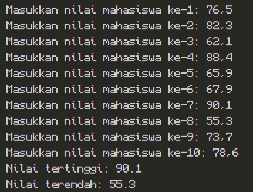
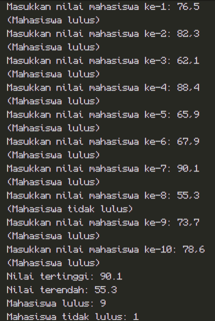
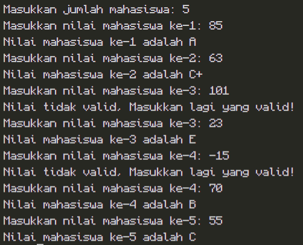
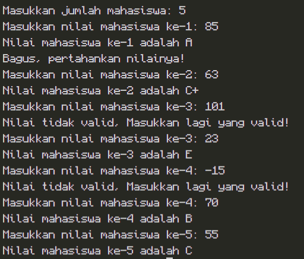
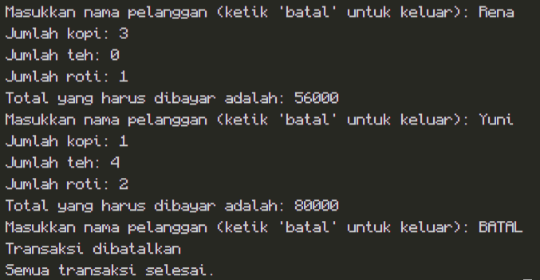

# JOBSHEET 7 - PERULANGAN 1

**Identitas Mahasiswa:**
* **Nama:** Muhammad Akbar
* **NIM:** 264107020029
* **Kelas / No. Presensi:** TI-1D/21

---

## 1: TUJUAN PRAKTIKUM

Berikut adalah tujuan pelaksanaan praktikum pada bab ini:

1. Mahasiswa dapat menjelaskan format penulisan program perulangan (for, while, dan do-while)
2. Mahasiswa dapat mengimplementasikan flowchart perulangan menggunakan bahasa pemrograman Java

---

## 2: HASIL PERCOBAAN & ANALISIS
### 2.1 Percobaan 1: Studi Kasus Nilai Mahasiswa di SIAKAD - Perulangan FOR 

Di dalam Sistem Informasi Akademik (SIAKAD), dosen mengisi nilai mata kuliah Praktikum Dasar Pemrograman yang ditempuh oleh mahasiswa. Dosen tersebut ingin mencari nilai tertinggi dan terendah Kuis dari 10 mahasiswa di dalam satu kelas. Dosen tersebut harus memasukkan nilai dari setiap siswa, kemudian menentukan dan menampilkan nilai tertinggi dan terendah.

#### 2.1.1 Kode Program Java
```java
import java.util.Scanner;

public class SiakadForNoAbsen {
    public static void main(String[] args) {
        Scanner sc = new Scanner(System.in);
        
        double nilai, tertinggi = 0, terendah = 100;
        
        for (int i = 1; i <= 10; i++) {
            System.out.print("Masukkan nilai mahasiswa ke-" + i + ": ");
            nilai = sc.nextDouble();
            
            if (nilai > tertinggi) {
                tertinggi = nilai;
            }
            if (nilai < terendah) {
                terendah = nilai;
            }
        }
        
        System.out.println("Nilai tertinggi: " + tertinggi);
        System.out.println("Nilai terendah: " + terendah);
    }
}

```

#### 2.1.2 Hasil Running / Screenshot Output



#### 2.1.3 Jawaban Pertanyaan / Pertanyaan Refleksi

* **Pertanyaan 1:** Sebutkan dan tunjukkan masing-masing komponen perulangan FOR pada kode program Percobaan 1!
  * **Jawab:** 
   1\. Inisialisasi -> ```int i = 1```
   2\. Kondisi -> ```i <= 10```
   3\. Update -> ```i++```


* **Pertanyaan 2:** Mengapa variabel tertinggi diinisialisasi 0 dan terendah diinisialisasi 100? Apa yang terjadi jika variabel tertinggi diinisialisasi 100 dan terendah diinisialisasi 0?
  * **Jawab:**
    Variabel tertinggi diinisialisasi 0 karena diseleksi menggunakan kondisi ```nilai > tertinggi``` dan jika `true` akan dijalankan pernyataan ```tertinggi = nilai```, maka jika ada nilai awal yang lebih dari 0, nilai tersebut secara otomatis akan menjadi nilai dari variabel tertinggi. Kemudian nilai tertinggi yang telah berubah tersebut akan dibandingkan dengan nilai yang baru diinput, jika kondisi bernilai `true` maka akan terjadi lagi proses diatas, jika `false` maka akan diabaikan.
    Variabel terendah diinisialisasi 100 karena diseleksi menggunakan kondisi ```nilai < terendah``` dan jika `true` akan dijalankan pernyataan ```terendah = nilai```, maka jika ada nilai awal yang kurang dari 100, nilai tersebut secara otomatis akan menjadi nilai dari variabel terendah. Kemudian nilai terendah yang telah berubah tersebut akan dibandingkan dengan nilai baru yang diinput, jika kondisi bernilai `true` maka akan terjadi lagi proses diatas, jika `false` maka akan diabaikan.
    Yang terjadi jika variabel tertinggi diinisialisasi 100 dan terendah diinisialisasi 0 adalah jika variabel tertinggi diinisialisasi kurang dari 100 dan terendah diinisialisasi lebih dari 0 maka proses seleksi nilai tidak akan berjalan dengan benar. Jika sebaliknya, variabel tertinggi diinisialisasi lebih dari 100 dan terendah diinisialisasi kurang dari 0 maka proses seleksi nilai akan tetap berjalan dengan benar. Kedua hal tersebut disebabkan karena rentang nilai adalah 0-100.

* **Pertanyaan 3:** Jelaskan fungsi dan alur kerja dari potongan kode berikut!

    ```java
    if (nilai > tertinggi) {
        tertinggi = nilai;
    }
    if (nilai < terendah) {
        terendah = nilai;
    }
    ```
  * **Jawab:**
    1\. ```if (nilai > tertinggi) {``` baris tersebut berisi kondisi untuk menyeleksi nilai tertinggi dengan membandingkan nilai yang diinput apakah lebih besar dari nilai di variabel tertinggi.
    2\. ```tertinggi = nilai;``` jika kondisi pada no 1 bernilai `true` maka baris ini akan dijalankan. Nilai yang baru saja diinput akan menggantikan nilai yang terdapat di variabel tertinggi sebelumnya. Jika bernilai `false` maka akan diabaikan.
    3\.  ```if (nilai < terendah) {``` baris tersebut berisi kondisi untuk menyeleksi nilai terendah dengan membandingkan nilai yang diinput apakah lebih kecil dari nilai di variabel terendah.
    4\.```tertinggi = nilai;``` jika kondisi pada no 3 bernilai `true` maka baris ini akan dijalankan. Nilai yang baru saja diinput akan menggantikan nilai yang terdapat di variabel terendah sebelumnya. Jika bernilai `false` maka akan diabaikan.
   
* **Pertanyaan 4:** Modifikasi kode program sehingga terdapat perhitungan untuk menentukan berapa mahasiswa yang lulus dan yang tidak lulus berdasarkan batas kelulusan (nilai minimal 60). Tampilkan jumlah mahasiswa lulus dan tidak lulus setelah menampilkan nilai tertinggi dan terendah!
  * **Jawab:** 
  ```java
  import java.util.Scanner;

    public class SiakadFor21Pertanyaan {
        public static void main(String[] args) {
            Scanner sc = new Scanner (System.in);

            double nilai, tertinggi = 0, terendah = 100;
            byte lulus = 0, tidakLulus= 0;
            
            for (int i = 1; i <= 10; i++) {
                System.out.print("Masukkan nilai mahasiswa ke-" + i + ": ");
                nilai = sc.nextDouble();
                if (nilai > tertinggi) {
                    tertinggi = nilai;
                } 
                if (nilai < terendah) {
                    terendah = nilai;
                }
                if (nilai >= 60) {
                    System.out.println("(Mahasiswa lulus)");
                    lulus++;
                } else {
                    System.out.println("(Mahasiswa tidak lulus)");
                    tidakLulus++;
                }
            } 
            System.out.println("Nilai tertinggi: " + tertinggi);
            System.out.println("Nilai terendah: " + terendah);
            System.out.println("Mahasiswa lulus: " + lulus);
            System.out.println("Mahasiswa tidak lulus: " + tidakLulus);
        }
    }
  ``` 
  Hasil run:

  


---

### 2.2 Percobaan 2: Studi Kasus Nilai Mahasiswa di SIAKAD - Perulangan WHILE

Seorang dosen ingin memasukkan nilai beberapa mahasiswa ke dalam SIAKAD untuk ditentukan kategori nilai hurufnya. Program harus meminta dosen untuk memasukkan nilai setiap mahasiswa. Jika dosen memasukkan nilai yang tidak valid (negatif atau lebih dari 100), program harus mengabaikan input tersebut dan meminta dosen untuk melakukan input ulang. Selanjutnya, nilai yang valid dikelompokkan ke dalam kategori huruf.

#### 2.2.1 Kode Program Java

```java
import java.util.Scanner;

public class SiakadWhileNoAbsen {
    public static void main(String[] args) {
        Scanner sc = new Scanner(System.in);
        
        int nilai, jml, i = 0;
        
        System.out.print("Masukkan jumlah mahasiswa: ");
        jml = sc.nextInt();
        
        while (i < jml) {
            System.out.print("Masukkan nilai mahasiswa ke-" + (i + 1) + ": ");
            nilai = sc.nextInt();
            
            if (nilai < 0 || nilai > 100) {
                System.out.println("Nilai tidak valid. Masukkan lagi nilai yang valid!");
                continue;
            }
            
            if (nilai > 80 && nilai <= 100) {
                System.out.println("Nilai mahasiswa ke-" + (i + 1) + " adalah A");
            } else if (nilai > 73 && nilai <= 80) {
                System.out.println("Nilai mahasiswa ke-" + (i + 1) + " adalah B+");
            } else if (nilai > 65 && nilai <= 73) {
                System.out.println("Nilai mahasiswa ke-" + (i + 1) + " adalah B");
            } else if (nilai > 60 && nilai <= 65) {
                System.out.println("Nilai mahasiswa ke-" + (i + 1) + " adalah C+");
            } else if (nilai > 50 && nilai <= 60) {
                System.out.println("Nilai mahasiswa ke-" + (i + 1) + " adalah C");
            } else if (nilai > 39 && nilai <= 50) {
                System.out.println("Nilai mahasiswa ke-" + (i + 1) + " adalah D");
            } else {
                System.out.println("Nilai mahasiswa ke-" + (i + 1) + " adalah E");
            }
            i++;
        }
    }
}

```

#### 2.2.2 Hasil Running / Screenshot Output



#### 2.2.3 Jawaban Pertanyaan / Pertanyaan Refleksi

* **Pertanyaan 1:** Pada potongan kode berikut, tentukan maksud dan kegunaan dari sintaks berikut:

```java
  if (nilai < 0 || nilai > 100) {
      System.out.println("Nilai tidak valid. Masukkan lagi nilai yang valid!");
      continue;
  }
  

```

  * **Jawab:** 
    a. `nilai < 0 || nilai > 100` = Nilai akan diperiksa apakah kurang dari 0 `ATAU` apakah lebih dari 100. Jika `iya` maka akan DICETAK output `"Nilai tidak valid. Masukkan lagi nilai yang valid!"`. Maksud dari kondisi ini adalah untuk membatasi input nilai dari user agar hanya dalam rentang 1-100.
    b. `continue` = Jika kondisi bernilai `true` maka `continue` akan dijalankan dan kode di dalam perulangan dibawah dari potongan kode tersebut akan diskip dan program akan kembali ke pengulangan dari atas/awal. 
* **Pertanyaan 2:** Mengapa sintaks `i++` dituliskan di akhir perulangan WHILE? Apa yang terjadi jika posisinya dituliskan di awal perulangan WHILE?
  * **Jawab:** Penulisan `i++` ditulis di akhir adalah agar variabel `i` bertambah setelah blok perulangan dijalankan seluruhnya dan berjalan sesuai dengan `i` saat itu. Jika input pengguna tidak valid dan sintaks `continue` dijalankan sehingga program kembali ke atas `i` tidak akan bertambah karena `i++` berada di bawah dan tidak dijalankan.
  Jika sintaks `i++` ditulis di awal maka variabel `i` akan bertambah meskipun input yang dimasukkan user tidak valid (tidak dalam rentang 1-100) dan program tidak menjalankan blok perulangan sepenuhnya, tetapi variabel `i` tetap bertambah. Hal ini menyebabkan program salah menghitung iterasi yang berhasil. Ini juga menyebabkan nilai `i` meleset 1 angka setiap user memasukkan input yang tidak valid.
  


* **Pertanyaan 3:** Apabila jumlah mahasiswa yang dimasukkan adalah 19, berapa kali perulangan WHILE akan berjalan?
  * **Jawab:**
    Perulangan WHILE akan berjalan sebanyak 19 kali jika input dari user semuanya valid. 
    Jika input dari user ada yang tidak valid maka perulangan akan berjalan lebih dari 19 karena sintaks `continue` dijalankan dan program melompat mengulangi perulangan WHILE tanpa menjalankan `i++`. Akibatnya, `i` tidak bertambah dan jumlah 19 mahasiswa tadi tidak berkurang. Setiap kali user memasukkan nilai yang salah, jumlah perulangan akan bertambah 1.


* **Pertanyaan 4:** Modifikasi kode program sehingga apabila terdapat mahasiswa yang mendapat nilai A, program menampilkan pesan tambahan "Bagus, pertahankan nilainya"!
  * **Jawab:** 
  ```java
  import java.util.Scanner;

    public class SiakadWhile21Pertanyaan {
        public static void main(String[] args) {
            Scanner sc = new Scanner(System.in);
            int jml, nilai, i = 0;

            System.out.print("Masukkan jumlah mahasiswa: ");
            jml = sc.nextInt();
            
            while (i < jml) { 
                System.out.print("Masukkan nilai mahasiswa ke-" + (i + 1) + ": ");
                nilai = sc.nextInt();

                if (nilai <0 || nilai > 100) {
                    System.out.println("Nilai tidak valid, Masukkan lagi yang valid!");
                    continue;
                }

                if (nilai > 80 && nilai <= 100) {
                    System.out.println("Nilai mahasiswa ke-" + (i + 1) + " adalah A");
                    System.out.println("Bagus, pertahankan nilainya!");
                } else if (nilai > 73 && nilai <= 80) {
                    System.out.println("Nilai mahasiswa ke-" + (i + 1) + " adalah B+");
                } else if (nilai > 65 && nilai <= 73) {
                    System.out.println("Nilai mahasiswa ke-" + (i + 1) + " adalah B");
                } else if (nilai > 60 && nilai <= 65) {
                    System.out.println("Nilai mahasiswa ke-" + (i + 1) + " adalah C+");
                } else if (nilai > 50 && nilai <= 60) {
                    System.out.println("Nilai mahasiswa ke-" + (i + 1) + " adalah C");
                } else if (nilai > 39 && nilai <= 50) {
                    System.out.println("Nilai mahasiswa ke-" + (i + 1) + " adalah D");
                } else {
                    System.out.println("Nilai mahasiswa ke-" + (i + 1) + " adalah E");
                }
                i++;
            }
        }
    }
  ``` 
  Hasil run:
  
  


---

### 2.3 Percobaan 3: Studi Kasus Transaksi di Kafe - Perulangan DO-WHILE

Di sebuah kafe, kasir ingin memproses transaksi beberapa pelanggan. Pelanggan dapat membeli lebih dari satu item, dan kasir akan terus memasukkan jumlah pembelian untuk setiap pelanggan. Jika ada pelanggan yang memutuskan untuk membatalkan transaksi (dengan memasukkan "batal"), maka kasir akan menghentikan input transaksi dan program berhenti.

#### 2.3.1 Kode Program Java

```java
import java.util.Scanner;

public class KafeDoWhile21 {
    public static void main(String[] args) {
        Scanner sc = new Scanner(System.in);

        int kopi, teh, roti;
        String namaPelanggan;
        int hargaKopi = 12000, hargaTeh = 7000, hargaRoti = 20000;
        int totalHarga;

        do { 
            System.out.print("Masukkan nama pelanggan (ketik 'batal' untuk keluar): ");
            namaPelanggan = sc.nextLine();
            if (namaPelanggan.equalsIgnoreCase("batal")) {
                System.out.println("Transaksi dibatalkan");
                break;
            }
            System.out.print("Jumlah kopi: ");
            kopi = sc.nextInt();
            System.out.print("Jumlah teh: ");
            teh = sc.nextInt();
            System.out.print("Jumlah roti: ");
            roti = sc.nextInt();
            totalHarga = (kopi*hargaKopi) + (teh*hargaTeh) + (roti*hargaRoti);
            System.out.println("Total yang harus dibayar adalah: " + totalHarga);
            sc.nextLine();
        } while (true);

        System.out.println("Semua transaksi selesai.");
    }
}
```

#### 2.3.2 Hasil Running / Screenshot Output



#### 2.3.3 Jawaban Pertanyaan / Pertanyaan Refleksi

* **Pertanyaan 1:** Pada penggunaan DO-WHILE ini, apabila nama pelanggan yang dimasukkan pertama kali adalah "batal", maka berapa kali perulangan dilakukan?
  * **Jawab:** Satu kali karena sudah masuk ke blok perulangan DO-WHILE (input nama pelanggan sudah berada di blok perulangan) oleh karena itu dihitung sekali.


* **Pertanyaan 2:** Sebutkan kondisi berhenti yang digunakan pada perulangan DO-WHILE tersebut!
  * **Jawab:**  Kondisi berhenti yang digunakan adalah menggunakan input pengguna yaitu `batal` yang dimana jika user menginput batal maka akan dijalankan perintah `break` yang menghentikan perulangan DO-WHILE di program.


* **Pertanyaan 3:** Apa fungsi dari penggunaan nilai `true` pada kondisi DO-WHILE?
  * **Jawab:** Penggunaan nilai true tersebut adalah untuk mengulang blok perulangan tersebut terus menerus selama belum ada input `batal` dari user yang menjalankan perintah `break`.


* **Pertanyaan 4:** Mengapa perulangan DO-WHILE tersebut tetap berjalan meskipun tidak ada komponen inisialisasi dan update?
  * **Jawab:** Karena dalam perulangan DO-WHILE yang diperiksa agar perulangan terus berjalan adalah input dari user sehingga tidak perlu inisialiasi dan update.


---

## 3: TUGAS MANDIRI

Berikut adalah daftar tugas yang dikerjakan pada Jobsheet ini:

* [x] **Tugas 1:** Program menghitung total penjualan tiket bioskop dalam satu hari (dengan ketentuan diskon)
* [x] **Tugas 2:** Program menghitung total pembayaran parkir kendaraan sesuai dengan *flowchart*

### 3.1 Implementasi Kode Tugas

#### Tugas 1 - Tiket Bioskop

```java
import java.util.Scanner;

public class Tugas1TiketBioskopDoWhile {
    public static void main(String[] args) {
        Scanner sc = new Scanner (System.in);

        // Deklarasi variabel
        int tiket, totalTiket = 0;
        double diskon;
        int hargaTiket = 50000;
        double totalHarga = 0;
        int pelanggan = 0;
        
        System.out.println("Masukkan 0 jika sudah tidak ada pelanggan lagi");
        // perulangan do while tiket
        do { 
            System.out.print("Masukkan jumlah tiket yang dibeli pelanggan " + (pelanggan + 1) +": ");
            tiket = sc.nextInt();
            if (tiket < 0) {
                System.out.println("jumlah tiket tidak valid, masukkan ulang");
                continue;
            } 
            if (tiket == 0){
                System.out.println("Input pelanggan sudah selesai");
                break;
            }
            // perhitungan total harga dan tiket
            if (tiket > 10) {
                diskon = 0.15;
                totalHarga += (hargaTiket-hargaTiket*diskon)*tiket;
                totalTiket += tiket;
            } else if (tiket > 4) {
                diskon = 0.1;
                totalHarga += (hargaTiket-hargaTiket*diskon)*tiket;
                totalTiket += tiket;
            } else {
                diskon = 0;
                totalHarga += (hargaTiket-hargaTiket*diskon)*tiket;
                totalTiket += tiket;
            }
            pelanggan++;

        } while (true);

        // output total
        System.out.println("---------------------------------------");
        System.out.println("Total tiket terjual: " + totalTiket);
        System.out.println("Total total harga penjualan tiket: " + totalHarga);
        System.out.println("Jumlah pelanggan hari ini: "+ pelanggan);
        System.out.println("---------------------------------------");

        sc.close();
    }
}
```

```java
import java.util.Scanner;

public class Tugas1TiketBioskopFor {
    public static void main(String[] args) {
        Scanner sc = new Scanner (System.in);

        // Deklarasi variabel
        int tiket, totalTiket = 0;
        double diskon;
        int hargaTiket = 50000;
        double totalHarga = 0;
        int i;
        int pelanggan;

        // input jumlah pelanggan
        System.out.println("---------------------------------------");
        do { 
            System.out.print("Masukkan jumlah pelanggan dalam satu hari: ");
            pelanggan = sc.nextInt();
            if (pelanggan < 0) {
                System.out.println("jumlah pelanggan tidak valid, masukkan ulang");
            }
        } while (pelanggan < 0);
        System.out.println("---------------------------------------");
        
        // perulangan while tiket
        for (i=0; i < pelanggan; i++) {
            //input jumlah tiket
            System.out.print("Masukkan jumlah tiket yang dibeli pelanggan " + (i + 1) +": ");
            tiket = sc.nextInt();
            if (tiket < 0) {
                System.out.println("jumlah tiket tidak valid, masukkan ulang");
                continue;
            }
            // perhitungan total harga dan tiket
            if (tiket > 10) {
                diskon = 0.15;
                totalHarga += (hargaTiket-hargaTiket*diskon)*tiket;
                totalTiket += tiket;
            } else if (tiket > 4) {
                diskon = 0.1;
                totalHarga += (hargaTiket-hargaTiket*diskon)*tiket;
                totalTiket += tiket;
            } else {
                diskon = 0;
                totalHarga += (hargaTiket-hargaTiket*diskon)*tiket;
                totalTiket += tiket;
            }
        }

        // output total
        System.out.println("---------------------------------------");
        System.out.println("Total tiket terjual: " + totalTiket);
        System.out.println("Total total harga penjualan tiket: " + totalHarga);
        System.out.println("---------------------------------------");

        sc.close();
    }
}
```

```java
import java.util.Scanner;

public class Tugas1TiketBioskopWhile {
    public static void main(String[] args) {
        Scanner sc = new Scanner (System.in);

        // Deklarasi variabel
        int tiket, totalTiket = 0;
        double diskon;
        int hargaTiket = 50000;
        double totalHarga = 0;
        int i = 0;
        int pelanggan;

        // input jumlah pelanggan
        System.out.println("---------------------------------------");
        do { 
            System.out.print("Masukkan jumlah pelanggan dalam satu hari: ");
            pelanggan = sc.nextInt();
            if (pelanggan < 0) {
                System.out.println("jumlah pelanggan tidak valid, masukkan ulang");
            }
        } while (pelanggan < 0);
        System.out.println("---------------------------------------");
        
        // perulangan while tiket
        while (i < pelanggan) {
            //input jumlah tiket
            System.out.print("Masukkan jumlah tiket yang dibeli pelanggan " + (i + 1) +": ");
            tiket = sc.nextInt();
            if (tiket < 0) {
                System.out.println("jumlah tiket tidak valid, masukkan ulang");
                continue;
            }
            // perhitungan total harga dan tiket
            if (tiket > 10) {
                diskon = 0.15;
                totalHarga += (hargaTiket-hargaTiket*diskon)*tiket;
                totalTiket += tiket;
            } else if (tiket > 4) {
                diskon = 0.1;
                totalHarga += (hargaTiket-hargaTiket*diskon)*tiket;
                totalTiket += tiket;
            } else {
                diskon = 0;
                totalHarga += (hargaTiket-hargaTiket*diskon)*tiket;
                totalTiket += tiket;
            }
            i++;
        }

        // output total
        System.out.println("---------------------------------------");
        System.out.println("Total tiket terjual: " + totalTiket);
        System.out.println("Total total harga penjualan tiket: " + totalHarga);
        System.out.println("---------------------------------------");

        sc.close();
    }
}
```

#### Tugas 2 - Biaya Parkir

```java
import java.util.Scanner;

public class Tugas2BiayaParkir {
    public static void main(String[] args) {
        Scanner sc = new Scanner (System.in);

        //deklarasi variabel
        int jenis, durasi, total = 0;

        // perulangan do-while
        do { 
            //input jenis kendaraan
            System.out.println("------------------------");
            System.out.println("1.Mobil\n2.Motor\n0.Keluar");
            System.out.print("Masukkan jenis kendaraan: ");
            jenis = sc.nextInt();
            // pemilihan jenis kendaraan
            if (jenis==1 || jenis==2) {
                System.out.println("------------------------");
                System.out.print("Masukkan durasi parkir: ");
                durasi = sc.nextInt();
                // perhitungan total biaya parkir
                if (jenis == 1) {
                    total += durasi*3000;
                } else {
                    total += durasi*2000;
                }
            }
        } while (jenis != 0);

        // output total
        System.out.println("------------------------");
        System.out.print("Total biaya parkir: Rp." + total);

        sc.close();
    }
}
```

---

## 4: KESIMPULAN

Perulangan penting untuk kondisi/intruksi yang berulang-ulang, sehingga tidak perlu menulis kode yang sama berkali-kali dan penulisan kode di program menjadi lebih efisien